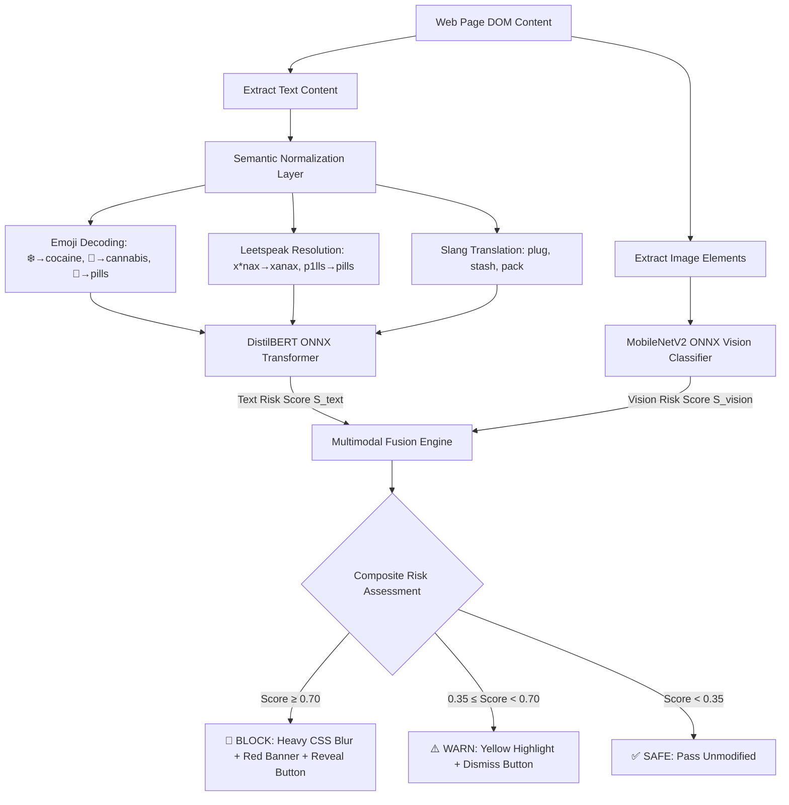

# 🛡️ DrugGuard: Algospeak-Resilient Multimodal Drug Trafficking Detection System

<!-- DrugGuard Banner -->
<p align="center">
  
</p>

<p align="center">
  <br/>
  <h1 align="center">🛡️ DrugGuard Detection System</h1>
  <p align="center"><strong>Algospeak-Resilient Multimodal Drug Trafficking Detection & Real-Time Intervention</strong></p>
</p>

<p align="center">
  <a href="paper/algospeak_paper.pdf"></a>
  <a href="paper/algospeak.md"></a>
  <a href="test_page.html"></a>
  <a href="https://fastapi.tiangolo.com/"></a>
  <a href="https://onnxruntime.ai/"></a>
  <a href="https://developer.chrome.com/docs/extensions/mv3/intro/"></a>
</p>

**Real-time client-side intervention system combining NLP Algospeak resilience, Computer Vision, and Chrome Extension DOM moderation.**

---

## 📌 System Architecture & Detection Flow

**DrugGuard** addresses the rapid growth of illicit drug trafficking on social media platforms, where sellers use evasive communication tactics—collectively known as **algospeak** (emojis like ❄️🍃💊, leetspeak, intentional misspellings like `x*nax`, `p1lls`, and coded jargon). Conventional keyword moderation filters fail against these obfuscation techniques, and platform-level moderation is often post-hoc (reactive).

DrugGuard solves this with a **hybrid multimodal detection architecture** operating in real-time with **sub-300ms latency**.

### 🖼️ System Architectural Diagram

<p align="center">
  
</p>
<p align="center"><em>Figure 1: Full System Architectural Diagram detailing raw content ingestion, semantic normalization, dual ML classifiers, multimodal fusion engine, and Chrome Extension DOM intervention.</em></p>

### 🔄 End-to-End Detection Flowchart



---

## 🔬 Core System Components

### 1. Semantic Normalization Layer
Before machine learning classification, raw text passes through a deterministic normalization pipeline:
- **Emoji Decoding**: Maps contextual drug emojis (e.g., ❄️ $\rightarrow$ cocaine, 🍃 $\rightarrow$ cannabis, 💊 $\rightarrow$ pills) into explicit semantic tokens.
- **Leetspeak & Character De-obfuscation**: Resolves obfuscated spellings (`x*nax` $\rightarrow$ `xanax`, `p1lls` $\rightarrow$ `pills`, `dr*gs` $\rightarrow$ `drugs`).
- **Slang Jargon Translation**: Normalizes underground trade jargon into standard vocabulary for transformer processing.

<p align="center">
  
</p>
<p align="center"><em>Figure 2: Semantic Normalization Pipeline transforming emojis, leetspeak, and slang into structured token sequences.</em></p>

### 2. Transformer NLP Text Classifier (DistilBERT ONNX)
- Uses a fine-tuned **DistilBERT** model converted to **ONNX Runtime** format for ultra-fast local inference.
- Evaluates contextual semantics and algospeak patterns, returning a text risk probability score $S_{text} \in [0, 1]$ and identified risk keywords.
- *Fallback Mechanism*: Includes a TF-IDF + Logistic Regression secondary pipeline if ONNX runtime is unavailable.

### 3. Computer Vision Image Classifier (MobileNetV2 ONNX)
- Analyzes visual content (images, post attachments, thumbnails) using a fine-tuned **MobileNetV2** CNN exported to ONNX format.
- Detects illicit substance imagery, pill press shapes, and drug paraphernalia, producing a vision risk probability score $S_{vision} \in [0, 1]$.

### 4. Multimodal Fusion Engine
Integrates text and image probability scores via a weighted decision algorithm:

$$\text{Risk Score} = w_t \cdot S_{text} + w_v \cdot S_{vision}$$

<p align="center">
  
</p>
<p align="center"><em>Figure 3: Multimodal Fusion Engine integrating NLP and Vision prediction vectors.</em></p>

- **High Risk ($\ge 0.70$ or explicit drug match)**: Triggers **BLOCK** action.
- **Medium Risk ($0.35 - 0.69$)**: Triggers **WARN** action.
- **Low Risk ($< 0.35$)**: Allows content as **SAFE**.

### 5. Client-Side Browser Intervention (Chrome Extension v4.0)
- **Non-intrusive DOM Blurring**: High-risk posts and illicit images are automatically blurred with heavy CSS filter (`blur(16px)`).
- **Top-Bar Action Banners**: Displays a sleek red top banner (`🛡️ Blocked: Coded drug content detected`) with a prominent **REVEAL** button.
- **Red Highlight on Reveal**: Clicking **REVEAL** un-blurs the content and highlights dangerous text in a distinct red left border and light red background.
- **Warning Highlight**: Medium-risk content is highlighted with a yellow background and border (no blur) with a **DISMISS** button.

---

## 📷 Extension Visual Demo & Control Panel

<p align="center">
  
</p>
<p align="center"><em>Figure 4: DrugGuard Chrome Extension v4.0 operating live on webpage DOM with real-time blur, top intervention banner, and stats panel.</em></p>

<p align="center">
  
</p>
<p align="center"><em>Figure 5: DrugGuard v4.0 Control Panel Popup UI with live session analytics and sensitivity controls.</em></p>

---

## 📊 Performance & Latency Metrics

<p align="center">
  
</p>
<p align="center"><em>Figure 6: End-to-End Processing Latency Breakdown demonstrating sub-300 ms real-time performance.</em></p>

---

## 📂 Project Structure

```
DrugGuard-Detection-System/
├── assets/                                                # Visual Assets & System Diagrams
│   ├── logo.svg                                           # Vector Shield Logo
│   ├── banner.svg                                         # GitHub Repository Header Banner
│   ├── architectural_diagram.png                          # System Architectural Diagram
│   ├── semantic_normalization.png                        # Semantic Normalization Pipeline Diagram
│   ├── multimodal_fusion.png                              # Multimodal Fusion Strategy Diagram
│   ├── end-to-end_processing_latency_breakdown.jpeg       # Processing Latency Benchmark
│   ├── extension_test_screenshot.png                      # Extension Live DOM Intervention Screenshot
│   └── extension_ui_dashboard.png                         # Extension Popup Control Panel Dashboard
├── backend/                                               # FastAPI REST Server & ML Pipeline
│   ├── server.py                                          # Inference API server with ONNX engine
│   ├── copy_assets.py                                     # Assets synchronization script
│   └── requirements.txt                                   # Python dependencies
├── extension/                                             # Chrome Extension Manifest V3 (v4.0.0)
│   ├── content_script.js                                  # DOM scraper & intervention engine (v4.0)
│   ├── popup.html                                         # Extension control panel dashboard
│   ├── popup.js                                           # Threshold & toggle logic
│   └── manifest.json                                      # Manifest V3 config
├── paper/                                                 # IEEE Academic Research Paper & PDF
│   ├── algospeak.md                                       # Full IEEE Research Paper (Markdown)
│   └── algospeak_paper.pdf                                # IEEE Research Paper Document (PDF)
├── train/                                                 # Fine-Tuned ONNX & ML Model Weights
│   ├── text_model.onnx                                    # DistilBERT ONNX Transformer
│   ├── image_model.onnx                                   # MobileNetV2 ONNX Vision Classifier
│   └── image_classes.json                                 # Class mapping index
├── test_page.html                                         # End-to-End Verification Test Webpage
└── README.md                                              # Project Documentation
```

---

## 🚀 Quick Start Guide

### 1. Start FastAPI Backend Server
```bash
cd backend
pip install -r requirements.txt
python server.py
```
*Server starts at `http://localhost:8000` loading ONNX models from `train/`.*

### 2. Load Chrome Extension
1. Open Chrome and go to `chrome://extensions/`.
2. Enable **Developer mode** (top right toggle).
3. Click **Load unpacked** and select the `extension/` directory.

### 3. Run Test Suite
Open `test_page.html` in Chrome (`http://127.0.0.1:5500/test_page.html`) to verify real-time text algospeak detection, vision recognition, warning highlights, and reveal overlays.

---

## 📄 IEEE Academic Research Paper

This project is backed by IEEE-formatted research paper:

- **Title**: *Algospeak-Resilient Drug Trafficking Detection Using Transformer-Based Machine Learning and a Browser Extension*
- **Authors**: Agalya M, Kalaipriya S, Sowndhar A, Rajalingam B
- **Affiliation**: KIT - Kalaignarkarunanidhi Institute of Technology, Coimbatore, India
- **Keywords**: Drug Trafficking Detection, Algospeak, Transformer Models, DistilBERT, Multimodal Learning, Semantic Normalization, Browser Extension, Real-Time Intervention.

### 🔗 Direct Access Paper Formats & Files:
* 📖 **IEEE Paper (Markdown)**: [`paper/algospeak.md`](file:///d:/Project/DrugGuard-Detection-System/paper/algospeak.md)
* 📄 **IEEE Paper (PDF)**: [`paper/algospeak_paper.pdf`](file:///d:/Project/DrugGuard-Detection-System/paper/algospeak_paper.pdf)

### 📊 Benchmark Accuracy Comparison:
| Model Architecture | Accuracy | F1-Score | Precision | Recall | Avg Latency |
|---|---|---|---|---|---|
| TF-IDF + Logistic Regression (Text) | 88.4% | 0.86 | 0.87 | 0.85 | 120 ms |
| MobileNetV2 CNN (Vision) | 85.2% | 0.83 | 0.84 | 0.82 | 150 ms |
| **DrugGuard Multimodal Fusion (Proposed)** | **94.0%** | **0.92** | **0.93** | **0.91** | **250–300 ms** |

---

## 🛡️ License

Academic Research & Educational License &copy; 2026 DrugGuard Team.
