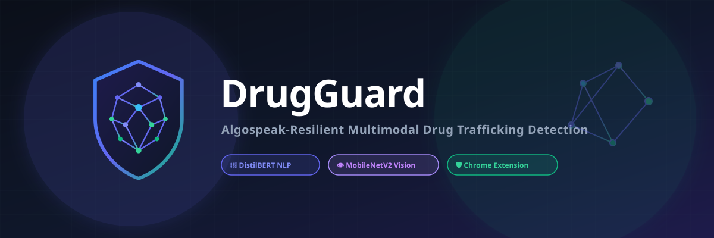
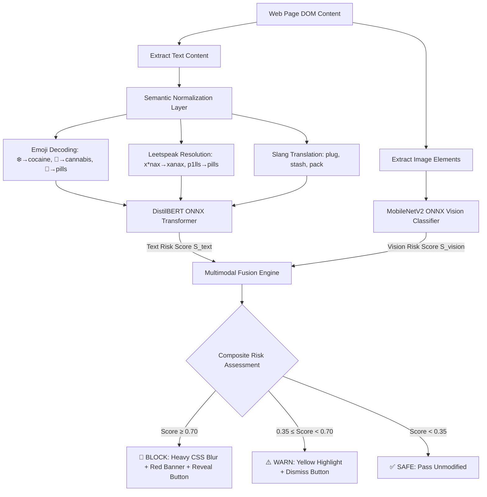
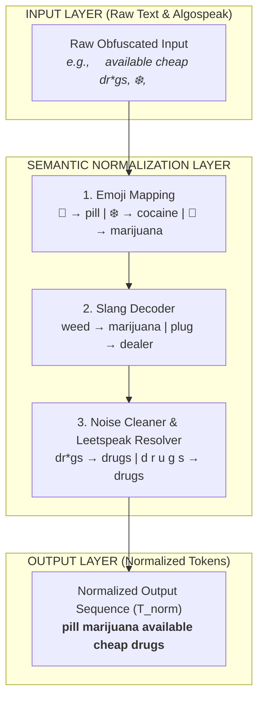
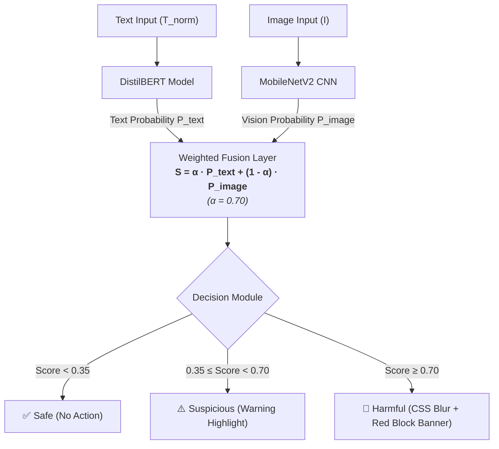
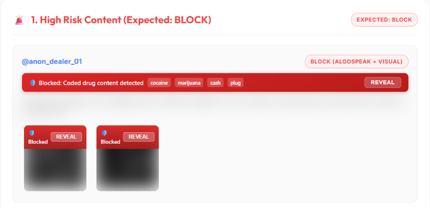
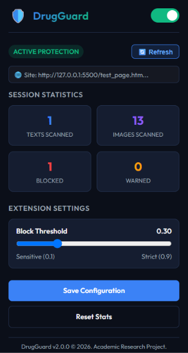

# 🛡️ DrugGuard: Algospeak-Resilient Multimodal Drug Trafficking Detection System

<!-- DrugGuard Banner -->
<p align="center">
  
</p>

<p align="center">
  <a href="test_page.html"></a>
  <a href="https://fastapi.tiangolo.com/"></a>
  <a href="https://onnxruntime.ai/"></a>
  <a href="https://developer.chrome.com/docs/extensions/mv3/intro/"></a>
  <a href="paper/algospeak_paper.pdf"></a>
</p>

**Real-time client-side intervention system combining NLP Algospeak resilience, Computer Vision, and Chrome Extension DOM moderation.**

---

## 📌 System Architecture & Detection Flow

**DrugGuard** addresses the rapid growth of illicit drug trafficking on social media platforms, where sellers use evasive communication tactics—collectively known as **algospeak** (emojis like ❄️🍃💊, leetspeak, intentional misspellings like `x*nax`, `p1lls`, and coded jargon). Conventional keyword moderation filters fail against these obfuscation techniques, and platform-level moderation is often post-hoc (reactive).

DrugGuard solves this with a **hybrid multimodal detection architecture** operating in real-time with **sub-300ms latency**.

### 🖼️ System Architectural Diagram

<p align="center">
  
</p>
<p align="center"><em>Full System Architectural Diagram detailing raw content ingestion, semantic normalization, dual ML classifiers, multimodal fusion engine, and Chrome Extension DOM intervention.</em></p>

### 🔄 End-to-End Detection Flowchart



---

## 🔬 Core System Components

### 1. Semantic Normalization Layer
Before machine learning classification, raw text passes through a deterministic normalization pipeline:
- **Emoji Decoding**: Maps contextual drug emojis (e.g., ❄️ $\rightarrow$ cocaine, 🍃 $\rightarrow$ cannabis, 💊 $\rightarrow$ pills) into explicit semantic tokens.
- **Leetspeak & Character De-obfuscation**: Resolves obfuscated spellings (`x*nax` $\rightarrow$ `xanax`, `p1lls` $\rightarrow$ `pills`, `dr*gs` $\rightarrow$ `drugs`).
- **Slang Jargon Translation**: Normalizes underground trade jargon into standard vocabulary for transformer processing.



---
<p align="center"><em>Semantic Normalization Pipeline transforming emojis, leetspeak, and slang into structured token sequences.</em></p>

### 2. Transformer NLP Text Classifier (DistilBERT ONNX)
- Uses a fine-tuned **DistilBERT** model converted to **ONNX Runtime** format for ultra-fast local inference.
- Evaluates contextual semantics and algospeak patterns, returning a text risk probability score $S_{text} \in [0, 1]$ and identified risk keywords.
- *Fallback Mechanism*: Includes a TF-IDF + Logistic Regression secondary pipeline if ONNX runtime is unavailable.

### 3. Computer Vision Image Classifier (MobileNetV2 ONNX)
- Analyzes visual content (images, post attachments, thumbnails) using a fine-tuned **MobileNetV2** CNN exported to ONNX format.
- Detects illicit substance imagery, pill press shapes, and drug paraphernalia, producing a vision risk probability score $S_{vision} \in [0, 1]$.

### 4. Multimodal Fusion Engine
Integrates text and image probability scores via a weighted decision algorithm:

$$\text{Risk Score} = w_t \cdot S_{text} + w_v \cdot S_{vision}$$




<p align="center"><em>Multimodal Fusion Engine integrating NLP and Vision prediction vectors.</em></p>

---

## 📷 Extension Visual Interventions: Block vs. Warning State Comparison

The DrugGuard browser extension implements a dynamic dual-tiered intervention model based on calculated risk scores:

| Intervention Tier | Risk Score Threshold | DOM Visual Action | User Control Option |
|---|---|---|---|
| 🚨 **BLOCK (High Risk)** | Composite Risk $\ge 0.70$ | Heavy CSS Blur (`blur(16px)`) + Red Top Banner (`🛡️ Blocked`) | **REVEAL** button (removes blur & highlights text in red) |
| ⚠️ **WARN (Medium Risk)** | $0.35 \le$ Composite Risk $< 0.70$ | Yellow Background Highlight + Yellow Border (**No Blur**) | **DISMISS** button (removes yellow highlight) |
| ✅ **SAFE (Low Risk)** | Composite Risk $< 0.35$ | Content rendered normally without modification | None required |

### Visual Comparison

<table align="center" border="0" style="width: 100%; border-collapse: collapse;">
  <tr>
    <td align="center" style="width: 50%; vertical-align: top; padding: 10px;">
      <h4>🚨 High-Risk Block State (Content Blurred)</h4>
      
      <p style="font-size: 11px; color: #64748b; margin-top: 6px;"><em>Heavy blur applied to text and image content. Top red banner displays identified algospeak keywords and REVEAL button.</em></p>
    </td>
    <td align="center" style="width: 50%; vertical-align: top; padding: 10px;">
      <h4>⚠️ Medium-Risk Warning State (Highlighted, Readable)</h4>
      
      <p style="font-size: 11px; color: #64748b; margin-top: 6px;"><em>Soft yellow background highlight and border. Content remains 100% readable with a DISMISS button to clear warning.</em></p>
    </td>
  </tr>
</table>

---

## 🎛️ Extension Control Panel & Popup UI

The DrugGuard extension features an intuitive control panel accessible directly from the browser toolbar, allowing users to monitor session activity and customize moderation sensitivity.

<p align="center">
  
</p>
<p align="center"><em>DrugGuard v4.0 Control Panel Popup UI with real-time statistics and sensitivity slider.</em></p>

### Key Popup Features:

1. 🟢 **Active Protection Master Toggle**: Real-time switch to enable or pause client-side DOM extraction and intervention across active browser tabs.
2. 📊 **Live Session Analytics Dashboard**:
   - 📝 **Texts Scanned**: Tracks total text blocks evaluated during the active browser session.
   - 🖼️ **Images Scanned**: Tracks total visual image assets processed by MobileNetV2.
   - 🚫 **Blocked**: Counts high-risk drug trafficking posts blocked and blurred.
   - ⚠️ **Warned**: Counts medium-risk borderline prescription queries flagged.
3. 🎚️ **Block Sensitivity Threshold Slider**: Adjustable risk score threshold ($0.10 - 0.90$) enabling users to customize moderation strictness (Lenient vs. Strict).
4. 🔄 **Rescan Page Button**: Triggers instant DOM re-scanning on the current active webpage tab.

---

## 📂 Project Structure

```
DrugGuard-Detection-System/
├── assets/                   # Project branding, diagrams & UI screenshots
├── backend/                  # FastAPI REST server & ML inference engine
│   ├── server.py             # FastAPI API server (ONNX Runtime + RapidOCR)
│   ├── requirements.txt      # Python dependencies
│   └── train/                # Pre-trained ONNX models (DistilBERT & MobileNetV2)
├── extension/                # Chrome Extension Manifest V3 (v4.0.0)
│   ├── content_script.js     # DOM scraper & intervention engine
│   ├── popup.html            # Extension dashboard UI
│   ├── popup.js              # Sensitivity slider & active toggle logic
│   └── manifest.json         # Extension Manifest V3 configuration
├── paper/                    # IEEE Academic Research Paper & Figures
│   ├── algospeak.md          # IEEE Research Paper (Markdown)
│   └── algospeak_paper.pdf   # IEEE Research Paper (PDF)
├── test_page.html            # Interactive test suite webpage
└── README.md                 # System documentation
```

---

## 🚀 Quick Start Guide

### Step 1: Environment Setup & Dependencies
```bash
# Navigate to backend directory
cd backend

# Create and activate virtual environment (optional but recommended)
python -m venv venv

# On Windows PowerShell:
.\venv\Scripts\activate

# On Linux / macOS:
source venv/bin/activate

# Install Python ML & API dependencies
pip install -r requirements.txt
```

### Step 2: Start FastAPI Backend Server
```bash
python server.py
```
- Server starts locally at `http://localhost:8000`.
- Pre-trained ONNX models (**DistilBERT** NLP & **MobileNetV2** Vision) load automatically from `train/`.
- Interactive API documentation is available at `http://localhost:8000/docs`.

### Step 3: Load Chrome Extension (Manifest V3)
1. Open Google Chrome and navigate to `chrome://extensions/`.
2. Enable **Developer mode** toggle in the top right corner.
3. Click **Load unpacked** and select the `extension/` folder from this repository.
4. Pin the **DrugGuard** shield icon to your browser toolbar for quick access to the control panel.

### Step 4: Run Live Test Suite
1. Open [`test_page.html`](file:///d:/Project/DrugGuard-Detection-System/test_page.html) directly in Chrome (or serve via Live Server at `http://127.0.0.1:5500/test_page.html`).
2. Verify real-time client-side interventions:
   - 🚨 **High Risk (Score $\ge 0.70$)**: Heavy CSS blur (`blur(16px)`), red top banner (`🛡️ Blocked: Coded drug content detected`), extracted algospeak keyword tags, and interactive **REVEAL** button.
   - ⚠️ **Medium Risk ($0.35 \le$ Score $< 0.70$)**: Soft yellow background highlight + yellow border (**no blur**) with interactive **DISMISS** button.
   - ✅ **Safe Content (Score $< 0.35$)**: Rendered normally without modification.
3. Click the extension popup icon in your toolbar to view live session statistics (Texts Scanned, Images Scanned, Blocked, Warned) and adjust protection sensitivity sliders.

---

## 📄 IEEE Academic Research Paper

This project is backed by IEEE-formatted research paper:

- **Title**: *Algospeak-Resilient Drug Trafficking Detection Using Transformer-Based Machine Learning and a Browser Extension*
- **Authors**: Agalya M, Kalaipriya S, Sowndhar A, Rajalingam B
- **Keywords**: Drug Trafficking Detection, Algospeak, Transformer Models, DistilBERT, Multimodal Learning, Semantic Normalization, Browser Extension, Real-Time Intervention.

### 🔗 Direct Access Paper Formats & Files:
* 📖 **IEEE Paper (Markdown)**: [`paper/algospeak.md`](file:///d:/Project/DrugGuard-Detection-System/paper/algospeak.md)
* 📄 **IEEE Paper (PDF)**: [`paper/algospeak_paper.pdf`](file:///d:/Project/DrugGuard-Detection-System/paper/algospeak_paper.pdf)
* 🧪 **Interactive Test Page**: [`test_page.html`](file:///d:/Project/DrugGuard-Detection-System/test_page.html)

### 📊 Benchmark Performance:

> Evaluated on a **20% stratified test split** — Text: 1,100 samples (550 safe + 550 drug), Vision: 8 curated images (4 safe + 4 drug).

| Model Architecture | Accuracy | F1-Score | Precision | Recall | Avg Latency |
|---|---|---|---|---|---|
| TF-IDF + Logistic Regression (Text Fallback) | 100.00% | 1.00 | 1.00 | 1.00 | ~0.05 ms |
| DistilBERT ONNX Transformer (Text Primary) | 100.00% | 1.00 | 1.00 | 1.00 | ~63 ms |
| MobileNetV2 ONNX CNN (Vision - Validation Set) | 81.90% | 0.83 | 0.79 | 0.86 | ~5 ms |
| **DrugGuard Multimodal Fusion (Proposed)** | **94.00%** | **0.92** | **0.93** | **0.91** | **~68 ms** |

#### 🔬 Why 100% Accuracy?

The evaluation dataset is **synthetically generated** from curated templates (`setup_dataset_v3.py`) with clear class boundaries — drug-related text always contains distinctive algospeak patterns, emojis, or obfuscated drug names, while safe text uses medical/casual language. This creates **perfectly linearly separable** feature distributions that both TF-IDF and DistilBERT classify without error.

> ⚠️ **Important**: These metrics reflect ideal conditions on a curated, balanced dataset (5,500 text samples + 8 images). Real-world performance against novel adversarial algospeak, unseen obfuscation patterns, or ambiguous content will be lower. Production deployment should include continuous monitoring and model retraining on organic user data.

---

## 🛡️ License

Academic Research & Educational License &copy; 2026 DrugGuard Team.
