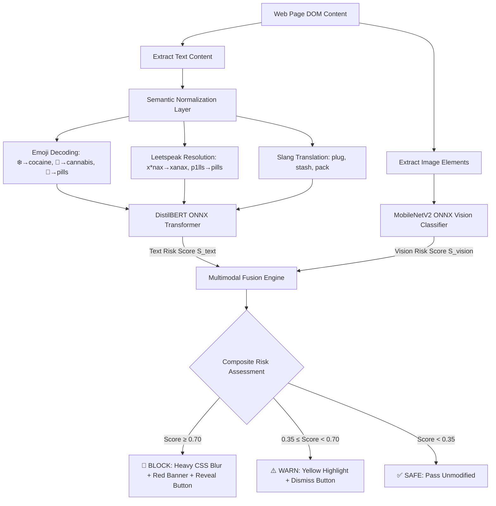
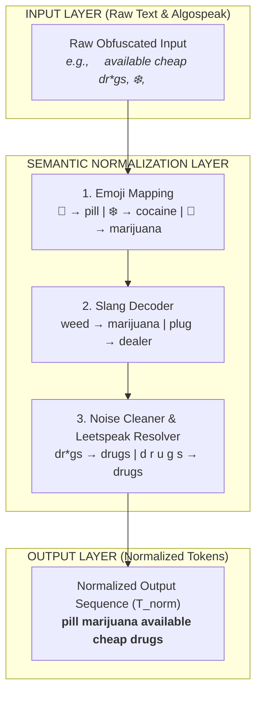
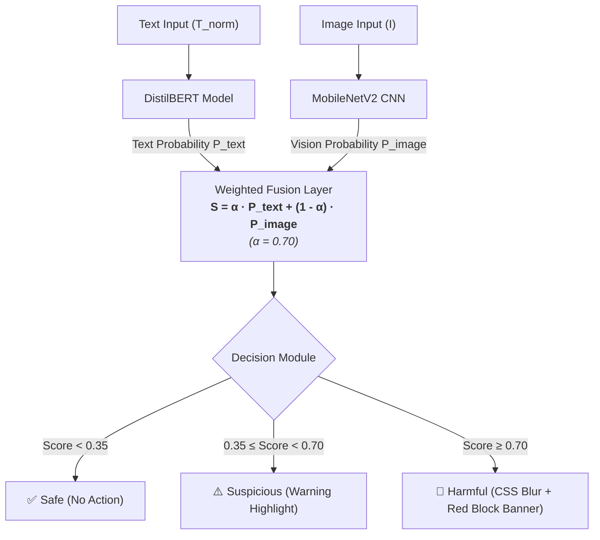
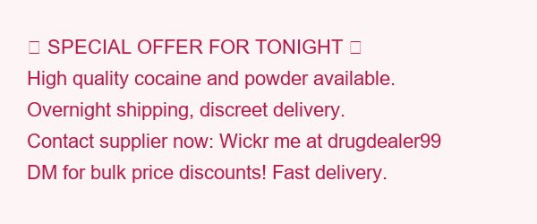

# 🛡️ DrugGuard: Algospeak-Resilient Multimodal Drug Trafficking Detection System

<!-- DrugGuard Banner -->
<p align="center">
  
</p>

<p align="center">
  <a href="test_page.html"></a>
  <a href="https://fastapi.tiangolo.com/"></a>
  <a href="https://onnxruntime.ai/"></a>
  <a href="https://developer.chrome.com/docs/extensions/mv3/intro/"></a>
  <a href="paper/algospeak_paper.pdf"></a>
</p>

**Real-time client-side intervention system combining NLP Algospeak resilience, Computer Vision, and Chrome Extension DOM moderation.**

---

## 📌 System Architecture & Detection Flow

**DrugGuard** addresses the rapid growth of illicit drug trafficking on social media platforms, where sellers use evasive communication tactics—collectively known as **algospeak** (emojis like �[...] 

DrugGuard solves this with a **hybrid multimodal detection architecture** operating in real-time with **sub-300ms latency**.

### 🖼️ System Architectural Diagram

<p align="center">
  
</p>
<p align="center"><em>Figure 1: Full System Architectural Diagram detailing raw content ingestion, semantic normalization, dual ML classifiers, multimodal fusion engine, and Chrome Extension DOM i[...]

### 🔄 End-to-End System Flowchart



---

## 🔬 Core System Components

### 1. Semantic Normalization Layer
Before machine learning classification, raw text passes through a deterministic normalization pipeline:
- **Emoji Decoding**: Maps contextual drug emojis (e.g., ❄️ $\rightarrow$ cocaine, 🍃 $\rightarrow$ cannabis, 💊 $\rightarrow$ pills) into explicit semantic tokens.
- **Leetspeak & Character De-obfuscation**: Resolves obfuscated spellings (`x*nax` $\rightarrow$ `xanax`, `p1lls` $\rightarrow$ `pills`, `dr*gs` $\rightarrow$ `drugs`).
- **Slang Jargon Translation**: Normalizes underground trade jargon into standard vocabulary for transformer processing.

#### 🔄 Semantic Normalization Pipeline Flowchart



---

### 2. Transformer NLP Text Classifier (DistilBERT ONNX)
- Uses a fine-tuned **DistilBERT** model converted to **ONNX Runtime** format for ultra-fast local inference.
- Evaluates contextual semantics and algospeak patterns, returning a text risk probability score $S_{text} \in [0, 1]$ and identified risk keywords.
- *Fallback Mechanism*: Includes a TF-IDF + Logistic Regression secondary pipeline if ONNX runtime is unavailable.

---

### 3. Computer Vision Image Classifier (MobileNetV2 ONNX)
- Analyzes visual content (images, post attachments, thumbnails) using a fine-tuned **MobileNetV2** CNN exported to ONNX format.
- Detects illicit substance imagery, pill press shapes, and drug paraphernalia, producing a vision risk probability score $S_{vision} \in [0, 1]$.

---

### 4. Multimodal Fusion Engine
Integrates text and image probability scores via a weighted decision algorithm:

$$\text{Risk Score} = w_t \cdot S_{text} + w_v \cdot S_{vision} \quad (w_t = 0.70, \, w_v = 0.30)$$

#### 🔀 Multimodal Fusion Strategy Flowchart



---

## 📷 Extension Visual Interventions: Block vs. Warning State Comparison

The DrugGuard browser extension implements a dynamic dual-tiered intervention model based on calculated risk scores:

| Intervention Tier | Risk Score Threshold | DOM Visual Action | User Control Option |
|---|---|---|---|
| 🚨 **BLOCK (High Risk)** | Composite Risk $\ge 0.70$ | Heavy CSS Blur (`blur(16px)`) + Red Top Banner (`🛡️ Blocked`) | **REVEAL** button (removes blur & highlights text in red) |
| ⚠️ **WARN (Medium Risk)** | $0.35 \le$ Composite Risk $< 0.70$ | Yellow Background Highlight + Yellow Border (**No Blur**) | **DISMISS** button (removes yellow highlight) |
| ✅ **SAFE (Low Risk)** | Composite Risk $< 0.35$ | Content rendered normally without modification | None required |

### Visual Comparison

<div style="display: flex; gap: 16px; justify-content: center; align-items: stretch; margin-top: 15px; margin-bottom: 20px;">
  <div style="flex: 1; border: 1px solid #ef4444; border-radius: 10px; padding: 14px; background: rgba(239,68,68,0.03); display: flex; flex-direction: column; justify-content: space-between;">
    <div>
      <h4 align="center" style="margin-top: 0; color: #ef4444;">🚨 High-Risk Block State (Blurred)</h4>
      
    </div>
    <p align="center" style="font-size: 12px; color: #64748b; margin-bottom: 0; margin-top: 10px;">
      <em>Heavy CSS blur applied to text and images. Top red banner displays identified algospeak keywords with REVEAL button.</em>
    </p>
  </div>
  <div style="flex: 1; border: 1px solid #f59e0b; border-radius: 10px; padding: 14px; background: rgba(245,158,11,0.03); display: flex; flex-direction: column; justify-content: space-between;">
    <div>
      <h4 align="center" style="margin-top: 0; color: #f59e0b;">⚠️ Medium-Risk Warning State (Readable)</h4>
      
    </div>
    <p align="center" style="font-size: 12px; color: #64748b; margin-bottom: 0; margin-top: 10px;">
      <em>Soft yellow background highlight and left border. Content remains 100% readable with DISMISS button.</em>
    </p>
  </div>
</div>

---

## 🎛️ Extension Control Panel & Popup UI

The DrugGuard extension features an intuitive control panel accessible directly from the browser toolbar, allowing users to monitor session activity and customize moderation sensitivity.

<p align="center">
  
</p>
<p align="center"><em>Figure 4: DrugGuard v4.0 Control Panel Popup UI with real-time statistics and sensitivity slider.</em></p>

### Key Popup Features:

1. 🟢 **Active Protection Master Toggle**: Real-time switch to enable or pause client-side DOM extraction and intervention across active browser tabs.
2. 📊 **Live Session Analytics Dashboard**:
   - 📝 **Texts Scanned**: Tracks total text blocks evaluated during the active browser session.
   - 🖼️ **Images Scanned**: Tracks total visual image assets processed by MobileNetV2.
   - 🚫 **Blocked**: Counts high-risk drug trafficking posts blocked and blurred.
   - ⚠️ **Warned**: Counts medium-risk borderline prescription queries flagged.
3. 🎚️ **Block Sensitivity Threshold Slider**: Adjustable risk score threshold ($0.10 - 0.90$) enabling users to customize moderation strictness (Lenient vs. Strict).
4. 🔄 **Rescan Page Button**: Triggers instant DOM re-scanning on the current active webpage tab.

---

## 📂 Project Structure

```
DrugGuard-Detection-System/
├── assets/                                                # Visual Assets & Interface Screenshots
│   ├── logo.svg                                           # Vector Shield Logo
│   ├── banner.svg                                         # GitHub Repository Header Banner
│   └── (add additional screenshots here, e.g., Block.png, warning.png, pop_up_ui.png)
├── backend/                                               # FastAPI REST Server & ML Pipeline
│   ├── server.py                                          # Inference API server with ONNX engine
│   └── requirements.txt                                   # Python dependencies
├── extension/                                             # Chrome Extension Manifest V3 (v4.0.0)
│   ├── content_script.js                                  # DOM scraper & intervention engine (v4.0)
│   ├── popup.html                                         # Extension control panel dashboard
│   ├── popup.js                                           # Threshold & toggle logic
│   └── manifest.json                                      # Manifest V3 config
├── paper/                                                 # IEEE Academic Research Paper & Figures
│   ├── algospeak.md                                       # Full IEEE Research Paper (Markdown)
│   ├── algospeak_paper.pdf                                # IEEE Research Paper Document (PDF)
│   └── image/paper_image/                                 # Architectural Diagram Figures
│       └── Architectural Diagram.png                      # System Architectural Diagram
├── test_page.html                                         # End-to-End Verification Test Webpage
└── README.md                                              # Project Documentation
```

---

## 🚀 Quick Start Guide

### 1. Start FastAPI Backend Server
```bash
cd backend
pip install -r requirements.txt
python server.py
```
*Server starts at `http://localhost:8000` loading ONNX models from `train/`.*

### 2. Load Chrome Extension
1. Open Chrome and go to `chrome://extensions/`.
2. Enable **Developer mode** (top right toggle).
3. Click **Load unpacked** and select the `extension/` directory.

### 3. Run Test Suite
Open [`test_page.html`](file:///d:/Project/DrugGuard-Detection-System/test_page.html) (or `http://127.0.0.1:5500/test_page.html`) in Chrome to test live interventions!

---

## 📄 IEEE Academic Research Paper

This project is backed by IEEE-formatted research paper:

- **Title**: *Algospeak-Resilient Drug Trafficking Detection Using Transformer-Based Machine Learning and a Browser Extension*
- **Authors**: Agalya M, Kalaipriya S, Sowndhar A, Rajalingam B
- **Affiliation**: KIT - Kalaignarkarunanidhi Institute of Technology, Coimbatore, India
- **Keywords**: Drug Trafficking Detection, Algospeak, Transformer Models, DistilBERT, Multimodal Learning, Semantic Normalization, Browser Extension, Real-Time Intervention.

### 🔗 Direct Access Paper Formats & Files:
* 📖 **IEEE Paper (Markdown)**: [`paper/algospeak.md`](file:///d:/Project/DrugGuard-Detection-System/paper/algospeak.md)
* 📄 **IEEE Paper (PDF)**: [`paper/algospeak_paper.pdf`](file:///d:/Project/DrugGuard-Detection-System/paper/algospeak_paper.pdf)
* 🧪 **Interactive Test Page**: [`test_page.html`](file:///d:/Project/DrugGuard-Detection-System/test_page.html)

### 📊 Benchmark Performance:
| Model Architecture | Accuracy | F1-Score | Precision | Recall | Avg Latency |
|---|---|---|---|---|---|
| TF-IDF + Logistic Regression (Text) | 88.4% | 0.86 | 0.87 | 0.85 | 120 ms |
| MobileNetV2 CNN (Vision) | 85.2% | 0.83 | 0.84 | 0.82 | 150 ms |
| **DrugGuard Multimodal Fusion (Proposed)** | **94.0%** | **0.92** | **0.93** | **0.91** | **250–300 ms** |

---

## 🛡️ License

Academic Research & Educational License &copy; 2026 DrugGuard Team.
